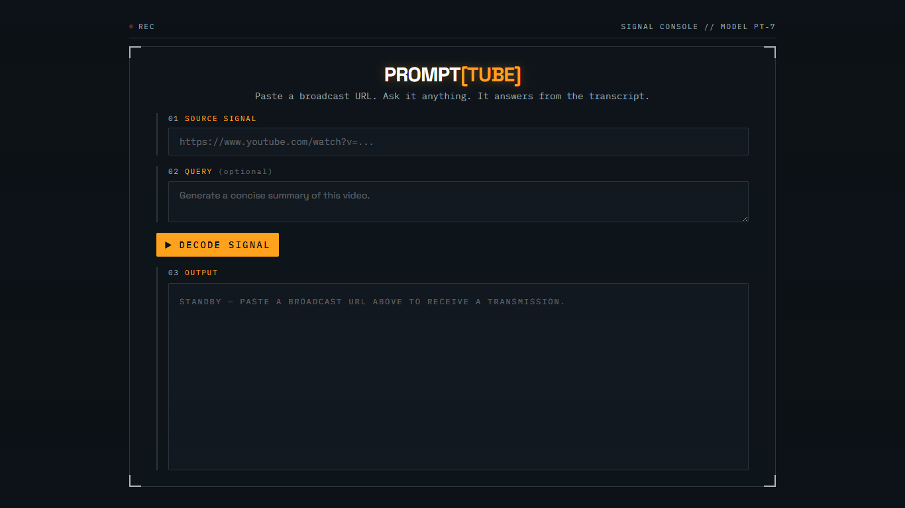

<div align="center">

# 🎥 PromptTube

### AI-powered conversations with any YouTube video

Turn YouTube videos and Shorts into interactive, promptable knowledge. Paste a YouTube URL, ask a question, and receive AI-generated responses grounded entirely in the video's transcript through a retro-futuristic signal console interface.

<p align="center">
  
  
  
  
  
  
</p>

<p align="center">
  <a href="https://prompt-tube.vercel.app"><strong>Live Demo</strong></a>
  •
  <a href="https://prompt-tube.onrender.com/docs"><strong>API Docs</strong></a>
  •
  <a href="https://github.com/aimanfazal/prompt-tube/issues"><strong>Report Bug</strong></a>
</p>

</div>

---

## Overview

PromptTube is a full-stack AI application that transforms YouTube videos into interactive, promptable knowledge.

Instead of searching through an entire video manually, simply paste a YouTube video (or Shorts) URL, provide an optional prompt, and PromptTube will retrieve the transcript, combine it with your request, and generate responses grounded entirely in the video's content.

The application uses the **Supadata API** for transcript retrieval and **Groq's Llama 3.3** models for AI-powered responses.

---

## Screenshots

<div align="center">
  
</div>

> A short demo GIF will be added in a future release.

---

## Features

- Transcript retrieval using the Supadata API
- Support for YouTube videos and Shorts
- AI-powered summaries and custom prompts
- Transcript-grounded responses
- Markdown-formatted output
- One-click copy and PDF export
- Responsive retro-futuristic signal console interface
- Fully typed FastAPI backend using Pydantic
- Production deployment on Vercel and Render

---

## Tech Stack

| Layer | Technology |
|--------|------------|
| Frontend | Next.js 15, React, TypeScript |
| Styling | Tailwind CSS |
| Backend | FastAPI, Python |
| Transcript API | Supadata |
| AI | Groq (Llama 3.3) |
| Deployment | Vercel, Render |

---

## Architecture

<details>
<summary><strong>Click to expand — request flow and system diagram</strong></summary>

<br>

```text
User Input
      │
      ▼
Next.js Frontend
      │
      ▼
FastAPI Backend
      │
      ▼
Supadata API
      │
      ▼
Prompt Construction
      │
      ▼
Groq Llama API
      │
      ▼
Generated Response
      │
      ▼
Frontend Console
```

### Processing Flow

1. User submits a YouTube video or Shorts URL along with an optional prompt.
2. The frontend sends a `POST /generate` request.
3. The backend extracts the video ID.
4. The transcript is retrieved from the Supadata API.
5. The transcript and prompt are combined into a single context.
6. The request is sent to Groq's OpenAI-compatible API.
7. The generated response is returned to the frontend and rendered inside the output panel.

</details>

---

## Project Structure

<details>
<summary><strong>Click to expand — repository layout</strong></summary>

<br>

```text
prompt-tube/
│
├── backend/
│   ├── app/
│   │   ├── api/
│   │   ├── schemas/
│   │   ├── services/
│   │   │   ├── youtube.py
│   │   │   └── llm.py
│   │   └── main.py
│   │
│   ├── requirements.txt
│   └── .env.example
│
├── frontend/
│   ├── app/
│   ├── components/
│   ├── lib/
│   ├── public/
│   └── .env.local.example
│
├── docs/
│   └── screenshots/
│
└── README.md
```

</details>

---

## Local Setup

<details>
<summary><strong>Click to expand — backend setup</strong></summary>

<br>

### 1. Create a virtual environment

```bash
cd backend

py -3.12 -m venv venv
source venv/Scripts/activate
```

### 2. Install dependencies

```bash
pip install -r requirements.txt
```

### 3. Configure environment variables

```bash
copy .env.example .env
```

```env
SUPADATA_API_KEY=your_supadata_api_key
GROQ_API_KEY=your_groq_api_key
GROQ_MODEL=llama-3.3-70b-versatile
FRONTEND_ORIGIN=http://localhost:3000
```

### 4. Start the backend

```bash
uvicorn app.main:app --reload --reload-dir app
```

Backend

```text
http://localhost:8000
```

API Documentation

```text
http://localhost:8000/docs
```

</details>

<details>
<summary><strong>Click to expand — frontend setup</strong></summary>

<br>

### 1. Install dependencies

```bash
cd frontend

npm install
```

### 2. Configure environment variables

```bash
copy .env.local.example .env.local
```

```env
NEXT_PUBLIC_API_BASE_URL=http://localhost:8000
```

### 3. Start the development server

```bash
npm run dev
```

Frontend

```text
http://localhost:3000
```

</details>

---

## Deployment

PromptTube is deployed as a split full-stack application.

| Service | Platform |
|----------|----------|
| Frontend | Vercel |
| Backend | Render |
| Transcript API | Supadata |
| AI Model | Groq |

---

## Roadmap

Planned improvements for future releases include:

- Navigation bar and footer
- Video metadata preview
- Response statistics
- Multiple console themes
- Saved conversations
- Semantic transcript search
- Study mode
- Quiz generation
- Timestamp-aware responses
- Progressive Web App (PWA)

---

## Development Process

PromptTube was built using an AI-assisted development workflow ("vibe coding") combined with manual engineering, debugging, deployment, and architectural decisions.

Some of the challenges solved during development include:

- Migrating from `youtube-transcript-api` to Supadata due to cloud IP restrictions
- Integrating Groq's OpenAI-compatible API
- Handling CORS between Vercel and Render
- Prompt construction and transcript grounding
- Responsive terminal-inspired interface design
- Production deployment across multiple platforms

---

## Contributing

Contributions, bug reports, feature requests, and documentation improvements are always welcome.

If you'd like to contribute:

- Fork the repository
- Create a feature branch
- Commit your changes
- Open a Pull Request

Small, focused contributions are the easiest to review and merge.

---

## License

This project is licensed under the MIT License.

---

<div align="center">

## Author

### Aiman Fazal

<a href="https://github.com/aimanfazal">
  
</a>

<br><br>

⭐ If you found PromptTube useful, consider giving the repository a star!

</div>